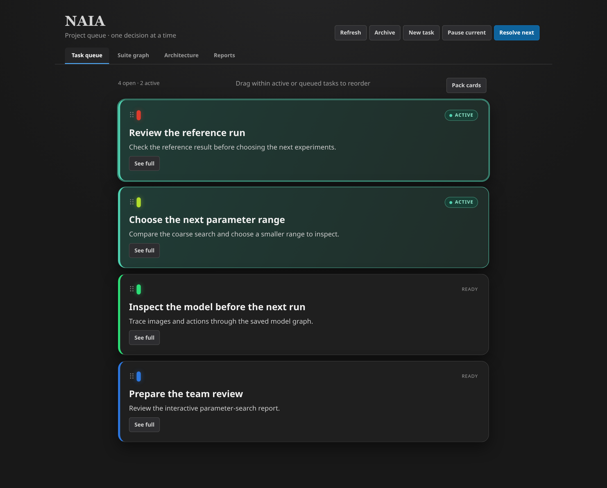
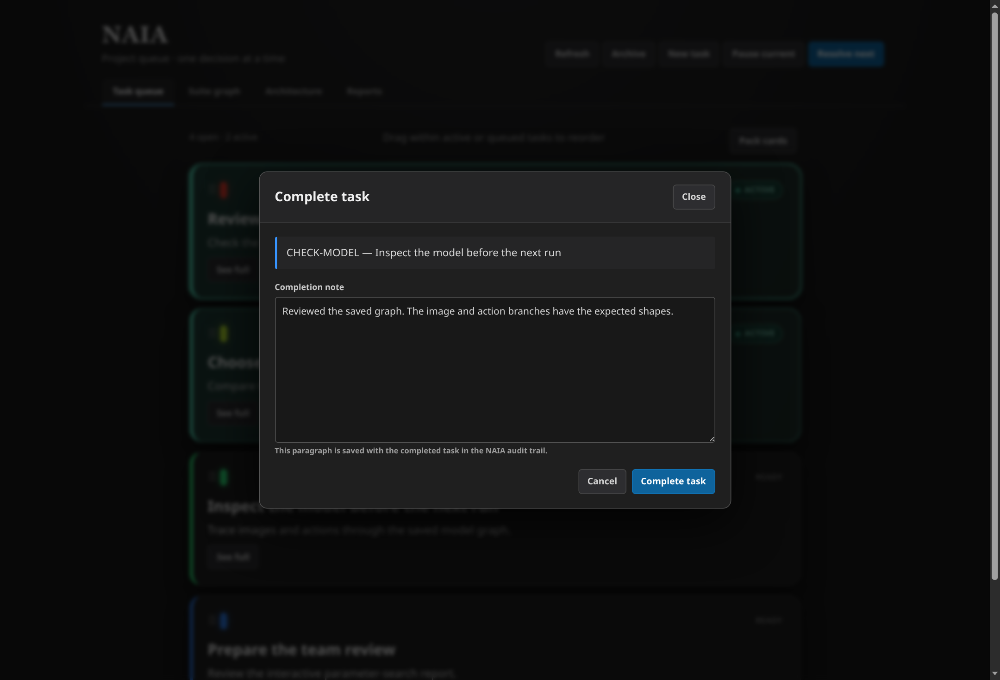
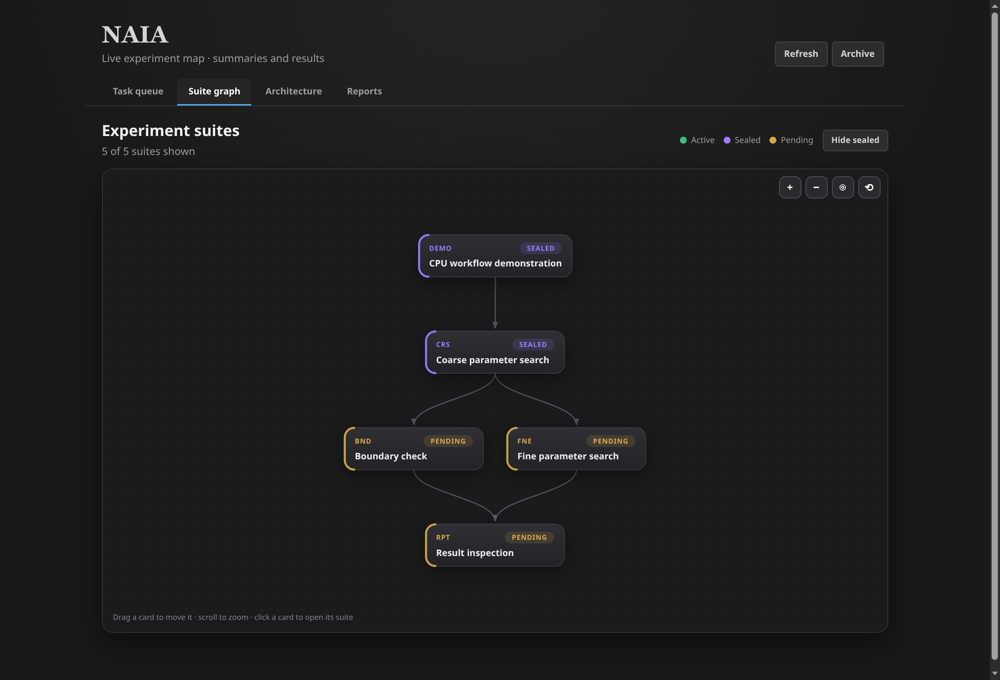
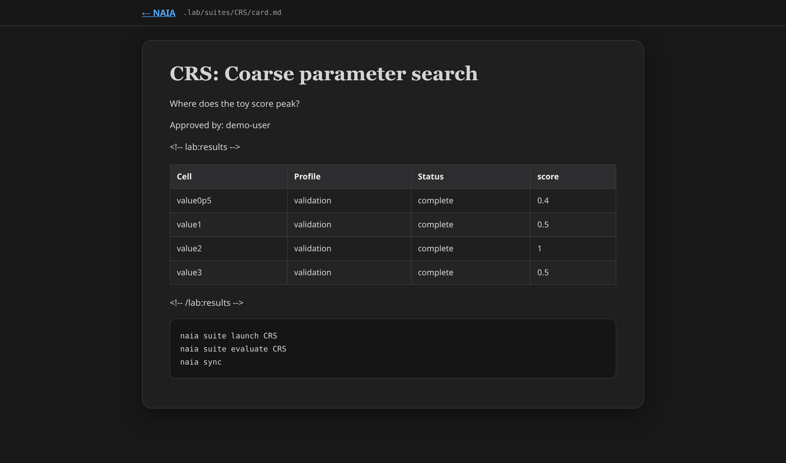
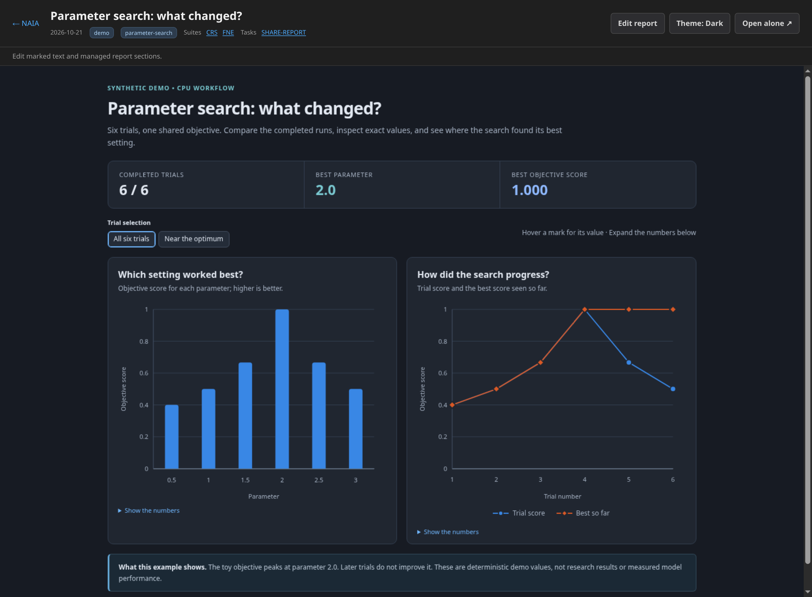
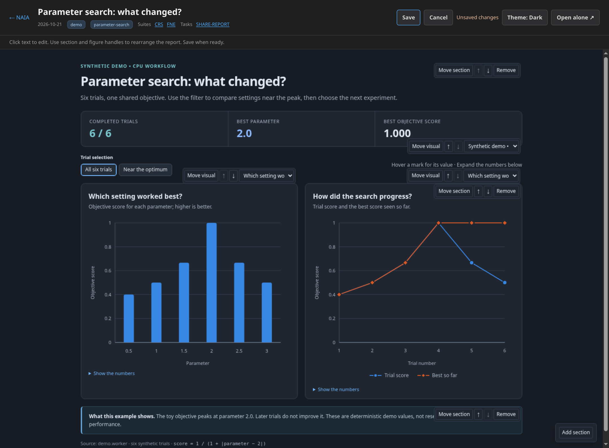
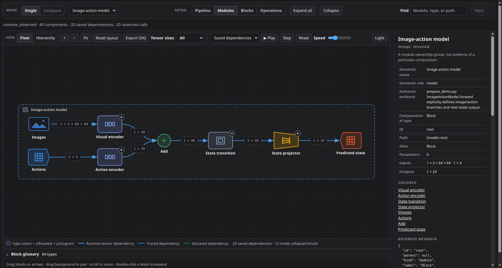

# Examples

[README](../README.md) · [Features](FEATURES.md) · [CLI](CLI.md)

These are requests to your existing Codex or Claude assistant, not built-in chat
commands. NAIA does not call an AI model. Once setup is complete, you do not need
to repeat the workflow rules.

The screenshots below use a small public demo: toy scores and an untrained model,
not private project data or research results.

## Setup

For the first project on a machine, give the assistant a concrete starting point:

> NAIA is installed as a command-line tool. Run `naia policy` and `naia --help`, then set up NAIA here for Codex and Claude.

Alternatively, run `naia init --assistant both` yourself, start a new assistant
session, and ask it to read the installed instructions and complete onboarding.

If you installed the optional skill with `naia assistant install --assistant both`,
you can simply say:

> Set up NAIA here.

If automatic matching does not pick it up, use `$naia-setup` in Codex or
`/naia-setup` in Claude Code. Start a new session if the skill is not yet visible.

The assistant reads existing instructions and inspection exclusions first, then
checks permitted README files, scripts, and configuration. NAIA's static scan
collects evidence; your assistant uses it to infer the project goal, training
commands, evaluation protocol, and other settings.

It shows a summary with file references for you to confirm or correct, then asks
only about missing or uncertain details. Proposals remain separate from confirmed
answers until you approve them. Existing confirmed settings are preserved.
For Slurm, share a submission script if the repository does not supply enough evidence.

## Tasks

> Remind me to review the baseline before increasing model capacity.

> Pause that review, assign the data audit to Alex, and show me the next task.

The assistant updates the queue. You can also edit task titles and goals, change
status, and reorder tasks in the browser. Several tasks can be active together;
they are highlighted at the top, and pausing restores their saved priority.

Choose **Unpack all** to see the queue and drag cards to reorder them. Open
**See full → Mark done** to complete a ready or paused task without starting it;
you can add a completion note.

## Experiments

> Test learning rates 0.0001, 0.0003, and 0.001.

The assistant resolves missing choices with you and prepares a suite using your
existing training and evaluation commands.

Drag suites to arrange the graph, scroll to zoom, and select one to open its card.

> Launch this suite.

It validates the suite, shows a dry-run plan, and launches the approved work.
Declared evaluations run automatically: sequentially locally, or after successful
training on Slurm.

> Retry the failed evaluations.

The assistant checks tracked attempts first. Completed work is reused; uncertain
job state needs investigation before retrying.

## Review

> What do these results tell us?

Results update the suite card, and a review task is queued when all declared
results are ready. The assistant discusses the findings; it records conclusions
only after you approve them.

> I approve that conclusion. Seal the suite.

Sealing prevents new training. It does not cancel jobs or block evaluations.

The card keeps the question, result table, and copyable launch commands together.

## Reports

> Assign Alex a probing analysis of these checkpoints.

NAIA records the assignment and its evidence paths. Alex or an assistant still
needs to perform the analysis.

> Turn this analysis into an interactive report and attach it to the review task.

The assistant uses approved results, adds HTML and metadata to the reports folder,
validates it, and checks it in the Reports tab. Search, tag filters, and related
task/suite links are provided by NAIA; figures and controls belong to the report.

Change the trial selection to filter the charts; hover for values or expand
**Show the numbers** to inspect the data. These controls are part of this example report.

Choose **Edit report** to change marked text and captions, add or remove sections,
or move sections and visuals. **Save** keeps the changes; **Cancel** discards
them. Editing does not change the chart data.

## Model inspection

> Show this model's layers and tensor sizes in Lens. Attach it to the baseline suite.

The assistant captures the model in its PyTorch environment and links the saved
graph. In Lens, expand blocks, inspect shapes, and play the captured forward calls.
Playback is illustrative, not a timing measurement. Saved graphs can also be
viewed without PyTorch or project setup.

Open **Architecture → Open full viewer** for more room. Switch detail levels or
double-click a block to expand it, select a component to inspect its metadata,
and use **Play** or **Step** to follow the saved execution path.
